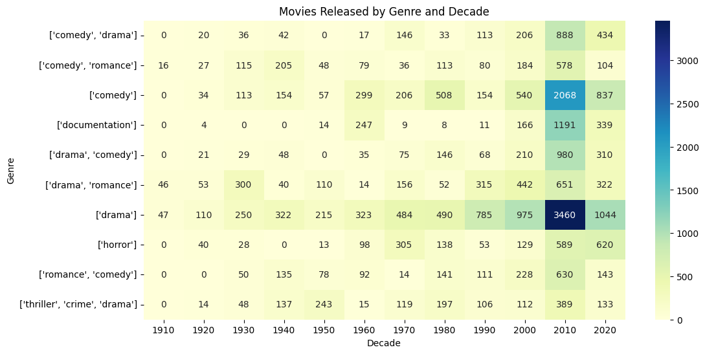
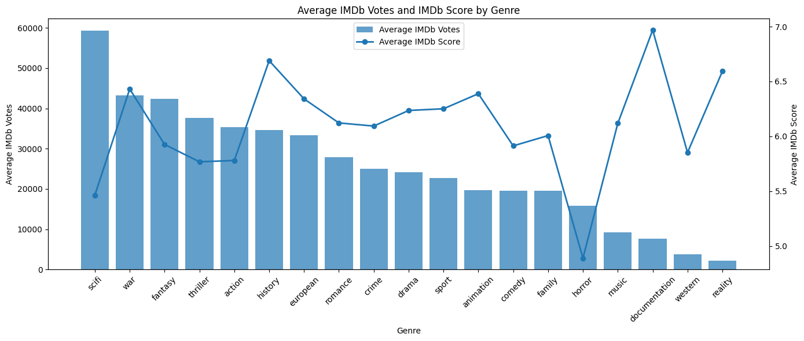
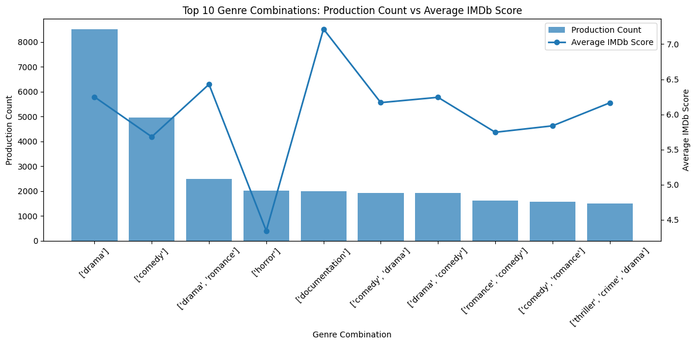
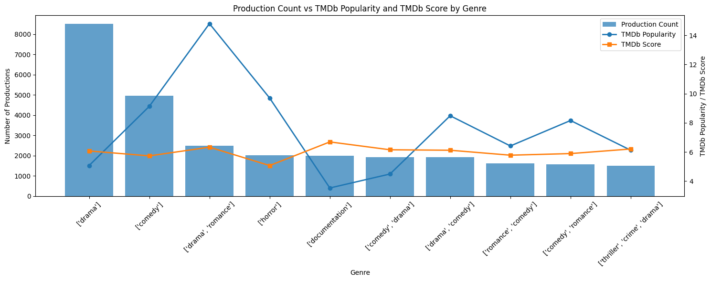
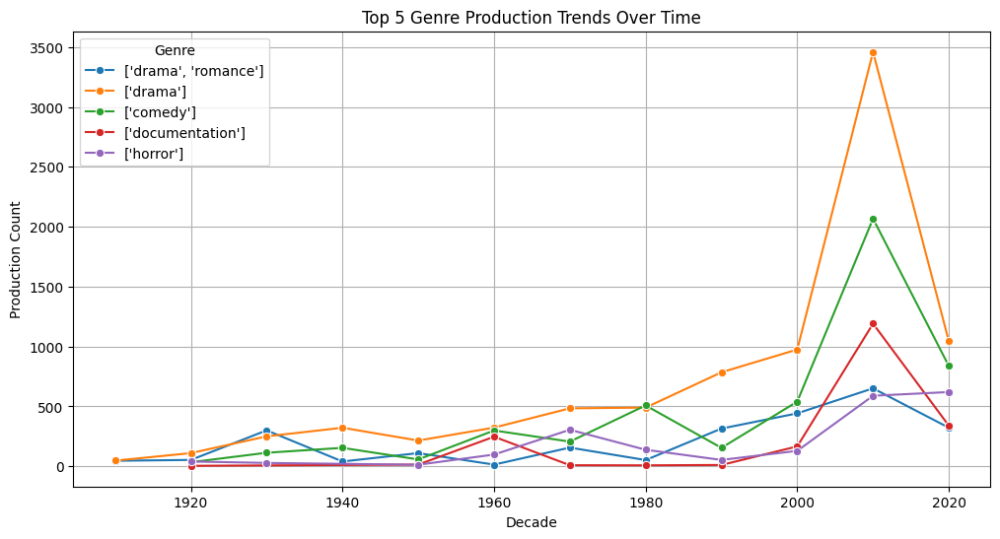
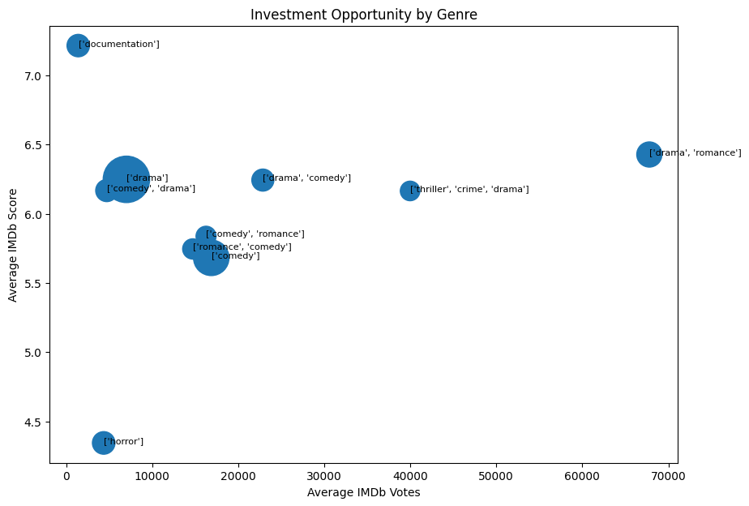
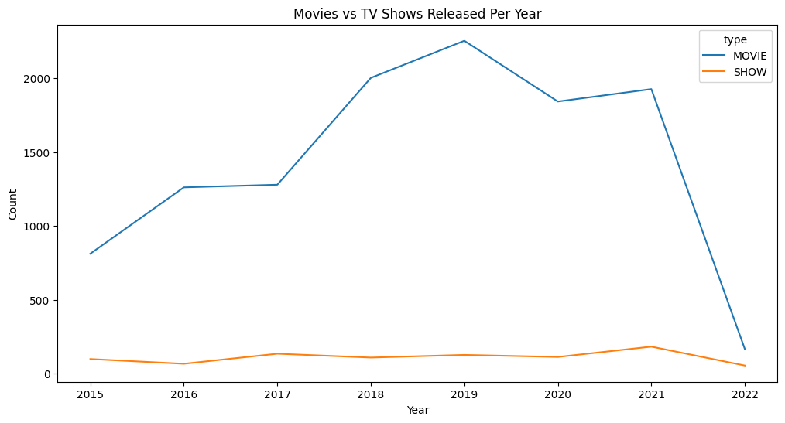
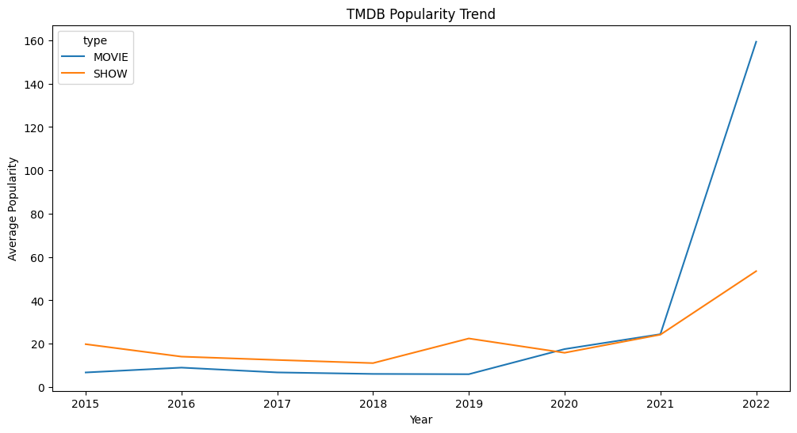

# 🎬 Amazon Prime Video: TV Shows & Movies EDA

**Exploratory Data Analysis of the Amazon Prime Video catalogue, turned into content-investment recommendations**

This project analyses the Amazon Prime Video library to understand **production trends, audience preferences and genre performance**, using IMDb and TMDB metrics. The goal is to produce business insights that can guide **content acquisition, production planning and investment decisions** for a streaming platform.

---

## 📌 Problem Statement

1. How have genre preferences changed across decades?
2. Are studios producing genres because they are **good**, or because they are **popular**?
3. How do popularity and score relate for each genre?
4. What are the top 5 genres over time?
5. Where should a streaming platform invest its next content budget?
6. Are there any hidden opportunities?
7. How do TV shows compare with movies?

---

## 🛠️ Tech Stack

| Area | Tools |
|---|---|
| Language | Python |
| Data handling | Pandas, NumPy |
| Visualisation | Matplotlib, Seaborn |
| Environment | Jupyter Notebook / Google Colab |

---

## 📂 Dataset

Two related files, joined on the title `id`:

| File | Rows | Contents |
|---|---|---|
| `titles.csv` | 9,871 titles (8,514 movies, 1,357 shows) | Title, type, description, release year (1912–2022), age certification, runtime, genres, production countries, seasons, IMDb score and votes, TMDB popularity and score |
| `credits.csv` | 124,235 credits (80,508 people) | Person ID, name, character and role (actor/director) per title |

After the inner join, the combined dataset had **124,347 rows and 19 columns**.

---

## 🧹 Data Cleaning

| Step | What was done |
|---|---|
| Duplicates | Removed 168 duplicate rows |
| Hidden nulls | Converted text placeholders (`missing`, `null`, `miss`, `Not available`) to real null values |
| `seasons` | Filled nulls with 0 (all nulls were movies) |
| `age_certification` | Dropped (over 54% missing) |
| `tmdb_score` | Filled nulls with the most frequent value (6.0) |
| `character` | Filled nulls with the most frequent value |
| Remaining nulls | Dropped rows in columns with under 5% missing |
| Dates | Converted `release_year` to datetime and created a `Decade` feature |
| Genres | Parsed the genre lists and exploded them for per-genre analysis |

**Result:** a clean dataset of **118,073 rows**, saved as `cleaned_data.csv`.

---

## 📊 Analysis & Visualisations

### 1. How genre preferences changed across decades


Drama has been the dominant genre throughout the last century. Comedy and documentary grew strongly after the 2000s, and **the 2010s were the biggest content boom**, matching the rise of global streaming. Hybrid genres such as drama–comedy and comedy–romance have become increasingly common.

### 2. Audience engagement vs. quality by genre


- **Sci-fi** has the highest audience engagement (votes) but only average ratings.
- **War** and **history** combine strong engagement with high ratings.
- **Documentary** is niche but highly rated.
- **Horror** has the weakest audience satisfaction.
- **Action** and **thriller** remain commercially attractive.

### 3. Are genres produced because they're good, or because they're popular?


| | Higher rating | Lower rating |
|---|---|---|
| **High production** | Drama, drama–romance | Comedy, horror |
| **Low production** | Documentary | Romance–comedy |

**Production volume does not guarantee quality.** Horror is overproduced relative to its ratings, while drama–romance is underproduced relative to its performance.

### 4. Popularity vs. score (TMDB)


TMDB popularity and TMDB score measure different things:
- **Documentary:** low popularity, high score. A small but very satisfied audience.
- **Horror:** high popularity, low score. Lots of interest, low satisfaction.
- **Drama–romance:** high popularity and a good score. Strong demand and good reception.

### 5. Top 5 genres over time


Drama is the clear market leader, followed by comedy. **Documentary is the fastest-growing niche genre**, drama–romance stays consistently popular, and horror is growing more slowly.

### 6. Where to invest the next content budget


*(x = average IMDb votes, y = average IMDb score, bubble size = production volume)*

- **Drama–romance is the strongest genre:** the highest votes (~68K) and a high score (~6.4).
- **Documentary is a hidden opportunity:** the highest score (~7.2) but low votes and low production volume.
- **Drama dominates production:** a proven, low-risk genre with moderate votes and ratings.
- **Horror is the weakest performer:** low votes and the lowest score.
- **Thriller–crime–drama performs well:** high votes (~40K) and a good score (~6.1).

### 7. TV shows vs. movies (2015–2022)



- **Movies dominate production volume**, making up most of the releases each year.
- **TV shows had higher average TMDB popularity than movies until 2019**, despite far lower volume.
- Audience popularity rose sharply for both formats in 2021–2022, most strongly for movies.

*Note: the dataset ends in 2022, so 2022 is a partial year.*

---

## 💡 Business Recommendations

| | Recommendation |
|---|---|
| 🎯 **Maximum audience reach** | Sci-fi, war, fantasy, action and thriller |
| 🏆 **Critical acclaim and awards** | Documentary, history and war |
| 📈 **Increase investment** | Crime and thriller: strong ratings and popularity without excessive market saturation |
| 💎 **Hidden opportunity** | Documentary and history: among the highest IMDb scores with comparatively low production, an underserved niche for premium content |
| ⚠️ **Prioritise quality over quantity** | Comedy and horror: high production volume but only average ratings |
| ⬇️ **Lower priority** | Horror, western and reality |

---

## ✅ Conclusion

Drama remains the safest, most-produced genre, but the best opportunities lie elsewhere. **Drama–romance** combines strong demand with high satisfaction, **documentary and history** are high-quality, underserved niches, and **crime and thriller** offer healthy demand without saturation. Horror and comedy show that producing more content does not mean producing better-received content.

---

## ▶️ How to Run

1. Clone this repository:
   ```bash
   git clone https://github.com/chetnamaurya/amazon-prime-video-eda.git
   ```
2. Install the dependencies:
   ```bash
   pip install numpy pandas matplotlib seaborn
   ```
3. Open `amazon-prime-analysis.ipynb` in Jupyter Notebook or Google Colab.
4. Update the file paths in the **Dataset Loading** cell to point to `titles.csv.zip` and `credits.csv.zip` (the notebook currently uses Google Drive paths from Colab).
5. Run all cells.

---

## 📁 Repository Structure

```text
├── amazon-prime-analysis.ipynb   # Full analysis notebook
├── titles.csv.zip                # Titles dataset
├── credits.csv.zip               # Credits dataset
├── images/                       # Charts used in this README
└── README.md
```

---

## 👤 Author

**Chetna Maurya**

[](https://www.linkedin.com/in/chetna-maurya-56a542431/)
